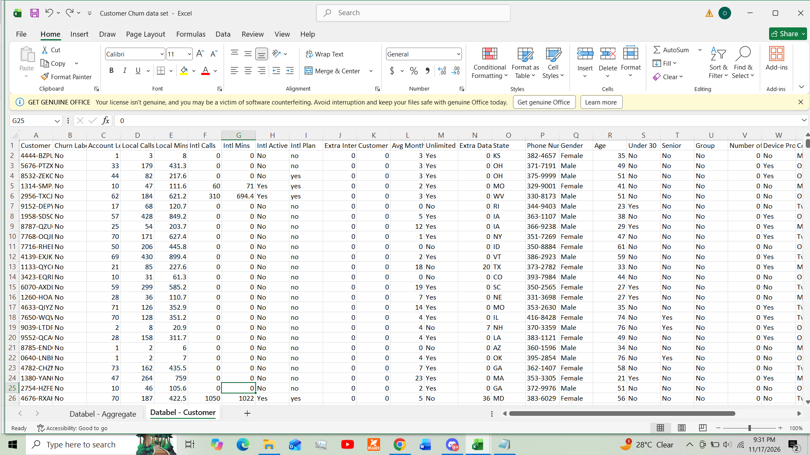
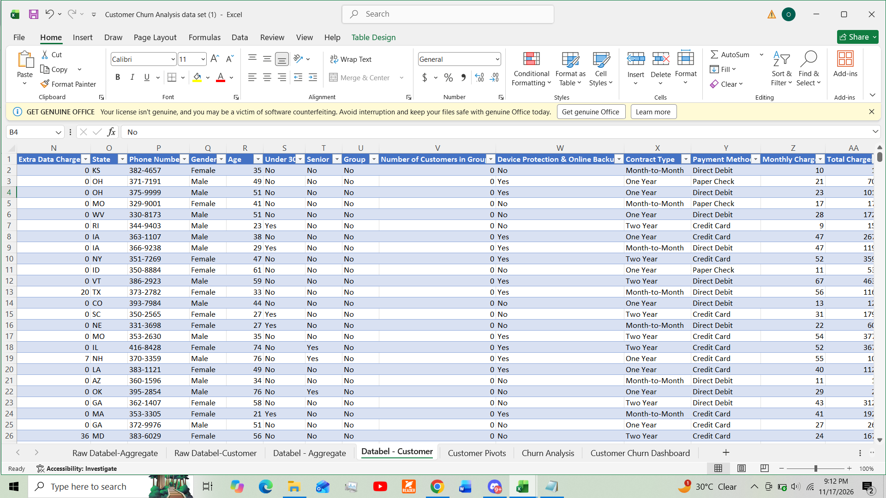
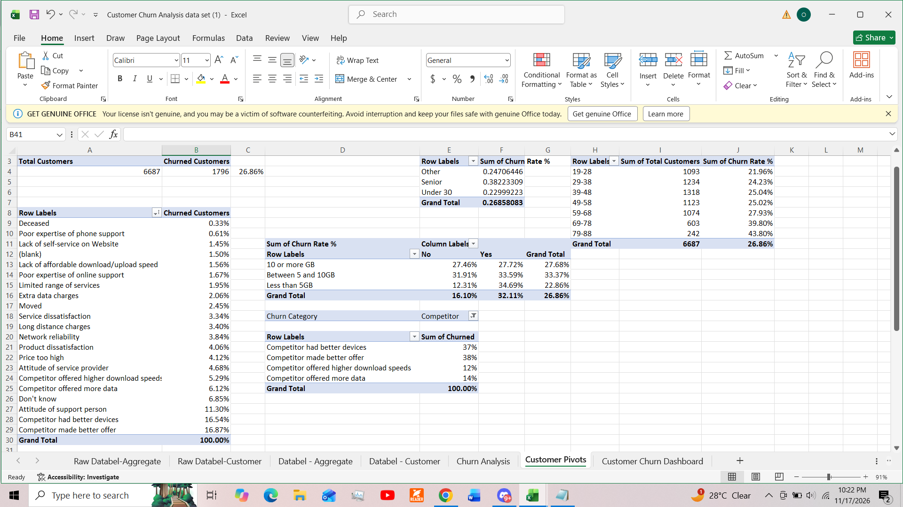
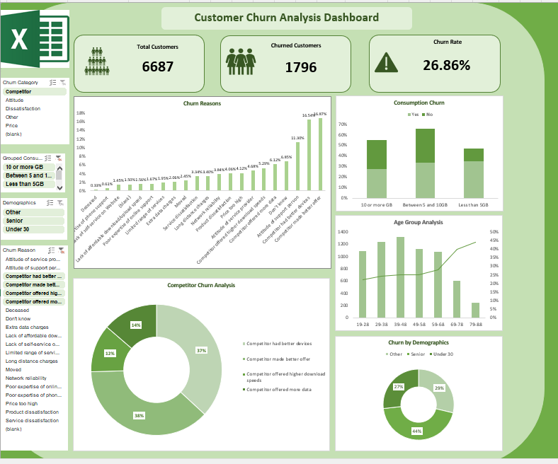

# Customer-churn-analysis-

## 📑TABLE OF CONTENT
*   [PROJECT OVERVIEW]
*   DATA SOURCE
*   TOOLS
*   OBJECTIVES & KEY PERFORMANCE INDICATORS
*   DATA CLEANING
*   DATA PREPROCESSING
*   DATA ANALYSIS
*   DASHBOARD
*   KEY INSIGHTS UNCOVERED
*   STRATEGIC RECOMMENDATIONS

##  Customer-churn-analysis OVERVIEW
This project analyzes customer churn data for a fictional telecommunications company, Databel.The analysis explores demographics, contract types, data consumption, and competitor offers using pivot tables and interactive dashboards.

##  📂DATASOURCE
The dataset was gotten from DataCamp (fictitious dataset)

##  🛠️TOOLS
*   Microsoft Excel (Nested IF formulas, PivotTables, Calculated Fields, Chart Formatting, Dashboard creation)

## 🎯OBJECTIVES & KEY PERFORMANCE INDICATORS
OBJECTIVES
*   Determine the overall churn rate and the total number of churned customers.
*   Analyze the primary reasons customers are leaving the company.
*   Investigate how factors like age, data consumption, and contract types influence churn.
*   Provide actionable, data-driven recommendations to improve customer retention and reduce revenue loss.

KEY PERFORMANCE INDICATORS
*   Total  Customers - 6,687
*   Total Customers Churned - 1,796
*   Overall Churn Rate - 26.86%

##  🧹DATA CLEANING

> Click the image above to see a preview of the raw dataset.

##  ⚙️DATA PREPROCESSING

> Click the image above to see a preview of the cleaned dataset.

##  DATA ANALYSIS

> Click the image above to see a preview of the pivot table.

##  📊DASHBOARD

> Click the image above to see a preview of the final dashboard.

## 🔍 KEY INSIGHTS UNCOVERED
Through exploratory data analysis using PivotTables and calculated fields, I uncovered the following insights:

### 1. General Overview
*   **Overall Churn Rate:** Approximately **~27%**
*   **Total Customers Churned:** Over **1,796** customers
*   **Primary Reason:** The most common reason for churn is related to **competitors offering better devices and better offers**.

### 2. Demographics (Age)
*   **Seniors Churn Most:** The churn rate for senior citizens is nearly **40%**.
*   **Age Groups:** The age group with the lowest number of customers actually has the highest churn rate (Seniors).
*   *Actionable Next Step:* Instead of generic retention emails, Databel needs to do a deeper analysis into *why* seniors are churning to provide targeted offers.

### 3. Data Usage
*   **Low Data Users:** Customers who consume the lowest amount of data (less than 5 GB) are the most likely to churn, with a rate of **34.69%**.

### 4. Contract Types & Account Length
*   **Month-to-Month:** As expected, Month-to-Month contracts have the highest overall churn.
*   **The Contract Gap:** Customers between the **3 and 4 year mark (37-48 months)** are much more likely to churn on a One Year contract compared to a Two Year contract. 
*   *Actionable Next Step:* Marketing can use this information to provide specific offers that push these customers to sign up for 2-year deals at the 3-year mark.

## 💡 STRATEGIC RECOMMENDATIONS
Based on the insights above, here are the recommended next steps for Databel's marketing and customer retention teams:

1. Targeted Retention for Senior Citizens

Action: Do not send generic retention emails to seniors. Because their churn rate is nearly 40%, Databel must conduct a deeper analysis into why seniors are leaving (e.g., are devices too complicated? Is customer support lacking?). Once the specific pain point is identified, create targeted loyalty programs or specialized support lines for this demographic.

2. Incentivize Data Usage

Action: Since low-data users (< 5GB) are churning at 34.69%, Databel should investigate if they feel they are paying for data they don't use. The company should offer "Right-Sized" plans for low-data users or provide tutorials/incentives to help them utilize their data more effectively, increasing their "stickiness" to the brand.

3. Bridge the Contract Gap (37-48 Months)

Action: Launch a targeted marketing campaign specifically for customers approaching their 3-year mark (37-48 months) on One-Year contracts. Offer them a compelling upgrade deal or a discount to transition them to a Two-Year contract, which has a demonstrably lower churn rate.

4. Counter Competitor Offers

Action: Since "better devices and offers" from competitors are the main drivers of churn, Databel needs a competitive pricing review. Implementing a "device upgrade" loyalty program for long-term customers (e.g., every 2 years) could prevent them from leaving for a competitor's newer hardware.

### 📫 Connect with me:
*   **Email:** oyenijibarakat2002@gmail.com
